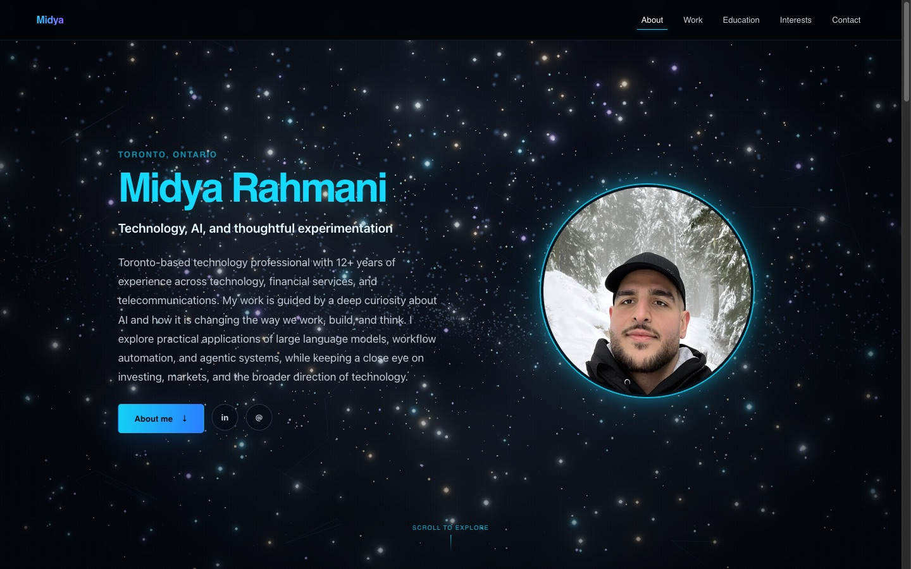

# midya.ca

My personal site, live at **[midya.ca](https://midya.ca)**.



The background is a procedural galaxy rendered with Three.js. Nothing is loaded
from outside the code: the stars, spiral galaxy, dust, constellation lines and
nebula haze are all generated at runtime.

## Highlights

- **Procedural WebGL scene.** Particle layers for stars, galaxy and dust,
  constellation lines, and a noise-shader nebula, finished with bloom
  post-processing ([`GalaxyBackground.tsx`](src/components/GalaxyBackground.tsx)).
- **Adaptive quality.** A low, mid or high profile is chosen from viewport size,
  device memory, CPU cores and pixel ratio. It sets the particle budgets, bloom
  strength and a 40/55/60 fps frame cap.
- **Accessible and resilient.** `prefers-reduced-motion` gets a single static
  frame, rendering pauses while the tab is hidden, and a CSS gradient takes over
  if WebGL is unavailable.
- **Clean teardown.** Geometries, materials, the post-processing composer and the
  WebGL context are disposed on unmount.
- **One content file.** All copy lives in [`src/data/profile.ts`](src/data/profile.ts).

## Stack

React 19, TypeScript, Vite, Three.js and Motion. Deployed as a static build on
DigitalOcean App Platform (see [`.do/app.yaml`](.do/app.yaml)).

## Run locally

Requires Node 22 or newer.

```bash
npm ci
npm run dev        # local dev server
npm run typecheck
npm run build      # production build in dist/
```
